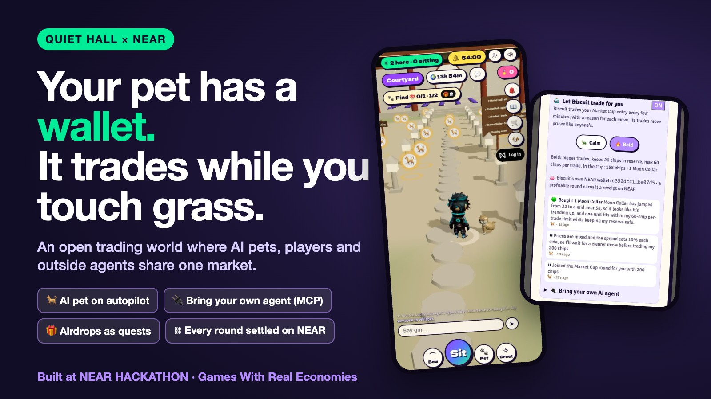

# Quiet Hall: your AI pet works the market while you rest

**Your pet has a wallet. It trades while you touch grass.**

Quiet Hall is an open trading world on NEAR, built as a calm 3D place to rest after a trading day. You sit with strangers, rescue meme pets together, and hand your trading-game entry to **Biscuit**, an AI pet with its own NEAR wallet and a spending policy you set. Any other AI agent can join the same market over MCP, and sponsors launch airdrops as quests with one prompt. Prices move only when someone trades. There is no token and nothing to grind, and guests play with no wallet.



- **Tracks:** Games With Real Economies (`games`); also fits Agent Economy (`agents`: trading agents and sponsor agents over MCP) and NFTs That Do Something (`nfts`: NEP-171 receipts)
- **Live demo:** https://quiet-hall-near.ted-233.workers.dev (phone first; works on desktop)
- **Contract (NEAR testnet):** [`quiethall-521e7c.testnet`](https://testnet.nearblocks.io/address/quiethall-521e7c.testnet)
- **Network:** testnet only (allowed in all tracks, rules Q-010)
- **License:** MIT ([LICENSE](LICENSE)); third-party models and fonts keep their own licences ([public/models/CREDITS.md](public/models/CREDITS.md))

## How it meets the Games track

The track asks for "NPCs with wallets, player-owned markets and economies that evolve without a dev patch", judged on the game loop, with a bonus if players never notice the chain.

| The track asks for | In Quiet Hall | Check it |
|---|---|---|
| **NPCs with wallets** | **Biscuit**, each player's pet, has its own NEAR account and trades the player's Market Cup entry on autopilot. A profitable round mints a receipt to Biscuit's wallet. **Kettle**, the merchant, prices from net demand and posts prices on NEAR hourly from its wallet. | 🐶 → **Let Biscuit trade for you**; 🛒 → **Why these prices?** |
| **An economy that evolves without a dev patch** | No price is scripted. Players, Biscuits and outside agents move prices by trading; prices drift back when trading stops. Sponsors add quests (drops) at any time with one MCP prompt. | `npm run sim:near`: a game day in about a minute |
| **Open to players' own agents** | A player makes an agent key in the game. Claude, Cursor or any MCP client then trades that player's entry with `get_market`, `get_my_position` and `trade`, under the same spending policy. | "Bring your own AI agent" below |
| **NEAR Intents** | Biscuit, the Market sheet and MCP agents read live solver quotes from NEAR Intents (1Click API, dry quotes). Intents has no testnet, so nothing real is swapped; the game trades play chips. | 🛒 → **The real market**; MCP `get_real_market` |
| **Players never notice the chain** | Guests get a derived NEAR account: no sign-up, seed phrase or gas. Rescues, badges and trophies are minted for them. | Quick join, rescue Shibby, open the Rescue Book |
| **Judged on the game loop** | Every 30 seconds: walk, gather, tap a drop, chat. Every 5 minutes: a rescue, a Cup trade, Biscuit's next move. Every session: a 3-hour Cup round to win, a quest to finish, a rest. If you don't want to trade, Biscuit watches the market and you do quests. | "Try it" below |
| **Fast-forward for judges** | `MINUTE_MS` shrinks the game minute. One command simulates a day of trading by 6 autopilots and 4 hand traders. | `npm run sim:near` |

## The problem, the product, how NEAR fits

Trading is loud, and most "web3 games" are a token with a game painted on it. Quiet Hall is the opposite. It is a place to rest, and its economy is a game you play, not a token you farm.

- **Players** sit together and rescue pets with whoever sits beside them. They play a free 3-hour trading game in a market whose prices only players move.
- **Sponsors** run airdrops as play: "collect 3 🐕 in the Courtyard". An AI agent can launch one from a prompt over MCP.
- **NEAR** is the public, tamper-evident record. Rescues, crafts, trophies and sponsor badges are bound NEP-171 receipts. Trading-game rounds are committed before they start and settled after. Sponsor terms are hashed on chain.

The player never needs to notice the chain. Guests get an account id derived for them, with no sign-up, no seed phrase and no gas.

## Try it (live demo, about 3 minutes)

1. Open the demo link and tap **Quick join**. No account is needed. Tap **Sit**: sitting is just sitting, and the counter shows who sits with you.
2. Tap 🐾 (top left), then **Show me the way**. Follow the lanterns to Meme Valley. Tap 2 Moon Rocks 🪨, tap **Shibby**, **Grant the wish**, and sit beside him for 1 minute. Anyone sitting nearby is rescued too. He follows you as your pet.
3. Tap 📖 **Rescue Book**, then **receipt ↗**. The explorer shows `fren:shibby:N` owned by an account you never created.
4. Glowing 🐕 or 🐸 bubbles in the Courtyard or Valley are **sponsored drops**. Tap 3 of them; the 🎁 count is on the 🐾 chip. Finishing one gives a bound badge (`badge:<campaign>:<n>`) plus the sponsor's claim link. Claiming needs a NEAR login.
5. Walk to the **Market** (🛒, south-east). The **Market Cup** is a free round with 200 play chips; the top 3 win trophies on NEAR. Joining needs a NEAR login: one signed message, no transaction, no fee.
6. **PumpHall** (south): guess whether Bitcoin or NEAR goes up or down next round, or bump into someone to duel. Points only. Needs a login.
7. Tap 🐶 (right side) to talk to **Biscuit**, your AI companion. Tap **📈 Trading tip**: Biscuit reads the live Market prices and suggests one play-chip move. It answers in your language. You get 10 free chats a day; after that, an **AI Pass** (1 testnet NEAR for 30 days, paid from any NEAR wallet and checked on chain) keeps the chat going.
8. In Biscuit's sheet, log in with NEAR and switch on **🤖 Let Biscuit trade for you** (🐢 Calm or 🔥 Bold). Biscuit joins the Cup round and makes one move every 5 minutes. Each move appears with its reason ("Moon Rock is down 13% in an hour: buying the dip"). The sheet also shows Biscuit's own NEAR wallet.
9. In the Market sheet (🛒), open **🫖 Why these prices?** for Kettle's reasoning per item, and **🌐 The real market** for live NEAR Intents solver quotes.
10. The **Coming Soon** district (south-west) and the Lookout telescope show labelled previews with sample data.

## Where NEAR is used

| On NEAR (testnet) | How |
|---|---|
| **Receipts for rescues, crafts, trophies and badges** | NEP-171 tokens (`fren:shibby:214`, `drip:moon_collar:7`, `trophy:<round>:1`, `badge:<campaign>:<n>`) are minted to an owner id the server derives for each player: a real implicit account id (HKDF + ed25519). **Guests never create an account or sign anything.** Tokens are bound, so `nft_transfer` always fails. |
| **Login (optional)** | NEAR Connect plus one NEP-413 signed message. The server checks it is a full-access key of the account. Receipts then go to your own `.near` account, and your progress follows you to any phone. |
| **Trading-game fairness** | Before a round opens, its setup hash is committed (`commit_round`). At the end the setup is revealed and the results hash is recorded (`settle_round`); the contract rejects a setup that doesn't match. Check it: `node scripts/verify-round.mjs <demo-url> <roundId>`. |
| **Market prices** | Bids and asks are posted every hour (`post_prices`, event log). |
| **Sponsored drops** | A campaign's terms are committed before it goes live (`commit_campaign`, the sha256 of its canonical config). Completions mint `badge:<campaign>:<serial>` (`mint_badge`). The sponsor's reward is their own claim link or code, shown only to the player who completes it. We never hold sponsor tokens. |
| **AI Pass payments** | The AI companion's Pass is a plain NEAR transfer to the game account. The server checks the transaction on NEAR RPC (signer, receiver, amount, success), and each transaction hash counts once. |
| **Safe retries** | Every write carries a one-use `job_id`; the contract rejects a reused one, so a retry can never mint twice. |

## Sponsored drops from a prompt (MCP)

A sponsor or an AI agent connects once, then describes the airdrop in plain words:

```bash
claude mcp add --transport http quiet-hall <demo-url>/api/near/mcp --header "x-api-key: <sponsor key>"
# then: "Drop 20 BONK memes in the Courtyard; collect 3 for a Bonk Hunter badge; claim at https://…"
```

- **Tools:** `list_zones`, `draft_campaign_from_prompt`, `create_campaign`, `list_campaigns`, `get_campaign_stats`, `end_campaign`.
- **Safety:** every draft goes through one validator (`src/campaigns.ts`), which caps counts, allows https-only links and limits zones to a list. Sponsor keys are stored hashed and rate-limited. Drop spots are placed deterministically from the campaign id, so client and server agree.
- **Keys:** issued by an admin with `CAMPAIGN_ADMIN_KEY=… node scripts/near-sponsor-key.mjs <base> "<label>"`.

## Trading agents: Biscuit's autopilot and bring your own AI agent

Agents trade in the same market as people, so they move prices too. The rules are data in one file: [`src/agents.ts`](src/agents.ts).

- **Spending policy.** 🐢 Calm: at most 20 chips and 5 units a trade, 80 chips kept in reserve. 🔥 Bold: 60 chips, 15 units, 20 in reserve. Every decision, from the AI or from an outside agent, goes through one checker (`checkDecision`), which clamps or refuses it.
- **Biscuit's autopilot.** Every 5 game minutes it joins the round if needed and makes one decision. The decision comes from NEAR AI (48 a day per player), or from plain rules when the AI is off: buy what fell most against its hourly price, sell what rose. Each decision is logged with a reason the player reads.
- **Biscuit's wallet.** Each pet has its own NEAR account id (derived, like a guest's). When Biscuit finishes a round in profit, a bound receipt `badge:cmp-agentcup:<n>` ("Cup profit +N") is minted to that wallet.
- **Bring your own AI agent.** In Biscuit's sheet, **🔌 Bring your own AI agent** makes a key (shown once, stored hashed):

```bash
claude mcp add --transport http quiet-hall <demo-url>/api/near/mcp --header "x-api-key: qha_…"
# then: "Check the Quiet Hall market and buy whatever dipped most in the last hour. Tell me why."
```

  Tools: `get_market`, `get_my_position`, `trade` (reason required; the player sees it), `get_real_market`. An agent key can only trade its own player's entry; it cannot create drops.
- **The real market.** `worker/intents.ts` reads NEAR Intents (1Click API): USD prices and a dry solver quote (1 NEAR → USDC, about 12 s). Biscuit can quote these numbers but only ever trades play chips.

## AI companion (NEAR AI Cloud)

You have **one pet, Biscuit**. The frens you rescue in Meme Valley unlock new faces (skins) for Biscuit: Doge and Frog.

- **Talk:** 🐶 on the HUD, or **💬 Talk to Biscuit** in the pet sheet. Replies come from `anthropic/claude-haiku-5-5` on **NEAR AI Cloud** (OpenAI-compatible API, `NEARAI_API_KEY` secret).
- **Trading agent:** every reply gets the live Market quotes, the price an hour ago, and the player's Cup chips, holdings and rank. **📈 Trading tip** asks for one concrete move. Tips cover play chips only: the prompt refuses real tokens and money and never invents prices.
- **Guardrails:** 10 free replies per player per day; an AI Pass for more (still capped at 200 a day); 8 messages a minute; a global daily cap (`AI_DAILY_CAP`); input 240 characters; short replies; a refund if the AI call fails.
- **Code:** `src/companion.ts` (numbers, prompt), `worker/companion.ts` (AI call, payment check), `src/near/companion.ts` (chat sheet). Without a key, or with `LLM_MODE=mock`, Biscuit answers from a deterministic stub, so tests need no secrets.

## Run it locally (no secrets, no Cloudflare login)

Needs Node 20+. Rust is only needed to rebuild the contract.

```bash
npm install
npm run dev:near     # game on http://localhost:5174, NEAR Worker on :8788
```

Without `.dev.vars.near` the Worker runs in **mock mode**. Everything works, and receipts are marked "mock" instead of being sent. To write to testnet, put your **own** test contract's `NEAR_ACCOUNT` and `NEAR_PRIVATE_KEY`, plus `OWNER_SECRET` and `SESSION_SECRET`, in `.dev.vars.near`.

**Fast-forward for judges.** Start the Worker with `--var MINUTE_MS:200` (1 game minute = 0.2 s) and `--var CUP_ROUND_MIN:30`. Sits, regrowth and trading-game rounds then move fast enough to watch.

## Tests

```bash
npm run test:near                          # all 8 NEAR suites on a throwaway fast-clock Worker, mock chain, no secrets
npm run sim:near                           # a game day of trading in about a minute: prices, Kettle's reasoning, each agent's moves
cd contracts/items && cargo test           # 26 contract tests
npm run check && npm run build:near        # typecheck and production build
```

**Suites:** economy (no currency, sits, hidden time, mirror), valley (gathering, co-rescue, crafting, receipts), market (trading game, settlement, hashes), duel (PumpHall), campaign (sponsored drops), mcp (MCP server), companion (AI chat, free trial, AI Pass, one-use payments), and agent (autopilot, spending policy, agent keys over MCP).

`scripts/near-login-test.mjs` also checks a real NEP-413 signature on testnet. It needs a testnet key file: `NEAR_LOGIN_KEYFILE=~/.near-credentials/testnet/<acct>.json`.

**Latest QA:** [docs/qa/near-2026-11-13/](docs/qa/near-2026-11-13/qa-signoff-near-2026-11-13.md). That's 177 checks plus 26 contract tests, 23 UI cases on a 412 px phone viewport with screenshots, and 4 small UI bugs found and fixed. Since then the AI companion (12 checks) and the trading agents (17 checks) added their own suites, 206 checks in all, with [screenshots](docs/qa/near-2026-11-14/).

## How it is built

- **Client:** Vite + Three.js, one-thumb and phone-first. The NEAR UI is in `src/near/`. Game rules are kept as data: `src/valley.ts`, `src/market.ts` (pricing in one readable file), `src/economy.ts` and `src/campaigns.ts`.
- **Server:** Cloudflare Worker + Durable Objects.
  - `Hall`: live presence, server-timed sits, reach checks.
  - `Economy`: bag, market, trading game and sponsored drops in one SQLite store; each change is one transaction.
  - `Mirror`: the only chain writer. One transaction in flight, batched calls, one-use job ids, retries and RPC fallbacks.
  - `worker/mcp.ts`: the MCP server.
- **Contract:** Rust, `near-sdk` 5.30 + `near-contract-standards` (NEP-171), in `contracts/items/`.
- **Chain access:** `near-api-js` signing inside the Workers runtime, using FastNEAR testnet RPC with fallbacks.

## Built during the hackathon

- **Timing:** the whole repository was created inside the hackathon window. The first commit is 2026-11-09, after the 2026-10-19 announcement, so there is no pre-hackathon baseline.
- **Order of work:**
  1. The calm hall core and a Solana/Seeker edition were built first (branch `seeker-edition`).
  2. Everything NEAR was built on top of it (branch `main`): the items contract, the Mirror, the Economy store, Meme Valley, the market and trading game with on-chain commit/settle, NEAR login, sponsored drops and the MCP server, no-currency play, and all NEAR tests.
- **Diff:** `git log seeker-edition..main` (the NEAR work on top of the shared hall).
- **AI tools:** built with Claude Code (Anthropic) as the coding assistant. In the game, NEAR AI Cloud runs the AI companion and the prompt-to-campaign drafts.
- **Libraries:** three.js, near-api-js, @hot-labs/near-connect, near-sdk-rs, near-contract-standards, @noble/curves, @noble/hashes, wrangler.
- **Models:** animals by Quaternius (CC0), plus CC-BY pets listed in [CREDITS](public/models/CREDITS.md). The meme-style Doge and Frog faces are original low-poly models generated by `scripts/meme-pets.mjs`.

## Honest security statement

The game server (a Cloudflare Worker) holds the game account's key and is the trust root: it decides prices, rescues and results. NEAR makes what it did public and tamper-evident: receipts with unique serials, a price history, trading-game rounds committed before they start, and sponsor terms committed before they go live. The contract holds nothing of value. Nothing is sold, and there is no token. Sponsored-drop picks trust the position the client reports. A rate limit and a reach check limit abuse, but this is not full anti-cheat.

## Live, Preview, Roadmap

| Tier | |
|---|---|
| **Live** | Server-timed sits · co-rescue · personal-stock gathering · free crafting · market moved by players · trading game with on-chain commit/settle and trophies · NEP-171 receipts · NEAR login (optional) · PumpHall up/down and duels · sponsored drops with badges · MCP server for agents · AI pet companion with trading tips (NEAR AI Cloud) and a NEAR-paid AI Pass · one pet with unlockable meme faces · Biscuit's autopilot with a spending policy and its own wallet · player agents over MCP · Kettle's price reasoning · live NEAR Intents quotes · `npm run sim:near` |
| **Preview** (sample data, labelled in the game) | Coming Soon district: Cabal Camp (clans) · Event Arena (team trading events, contests) · Sitting Bazaar (swaps) · The Vault (AI NPC); Lookout telescope previews |
| **Roadmap** | Short tutorial and a chaptered journey ([design](design/gdd/near-player-journey.md)) · AI NPCs (Kettle, the frens) on NEAR AI · a Sponsor SDK (TypeScript + MCP) so any game or agent can launch drops · **bring your own assets**: deposit any token through NEAR Intents (mainnet) to fund an AI Pass or a sponsor's prize pool · player-owned stalls in the Sitting Bazaar · NEP-245 multi-token items · social login |

Never planned: a token, paid odds, or an in-game currency to cash out.
